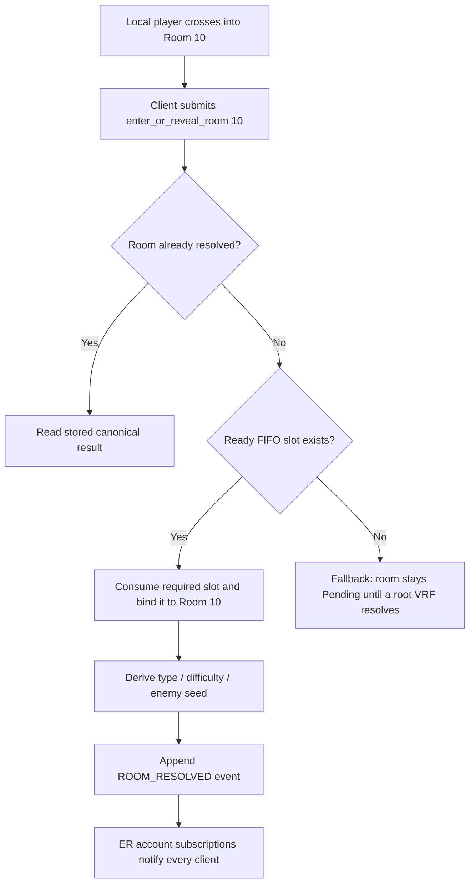
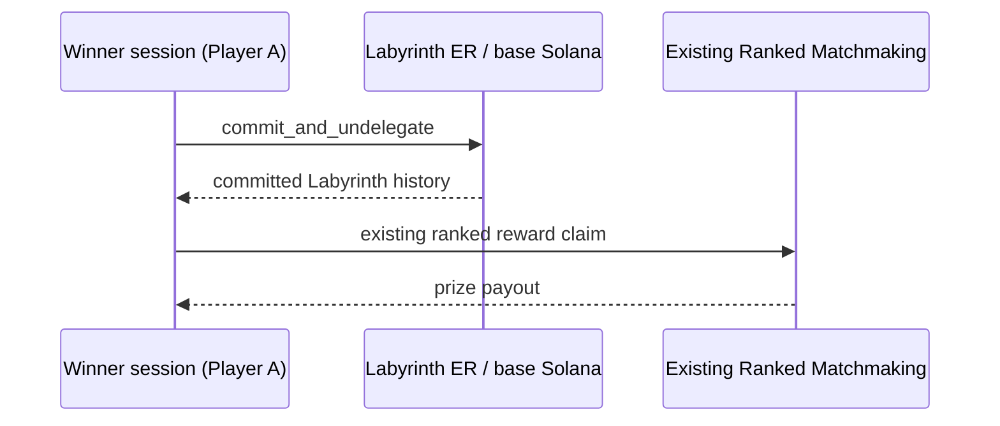

# Labyrinth pre-generated VRF pools

## Player-paid bootstrap connection (v5)

The alternatives below are preserved unchanged. Before either room-randomness
pool can be used, the selected player Session Key completes the v5 player-paid
Match/Event-Chunk initialization and chunk-first delegation stage. Colyseus
signs the immutable permit and observes readiness; it does not pay or submit
bootstrap transactions. See [Player-paid ER bootstrap](docs/PLAYER_PAID_ER_BOOTSTRAP.md)
for launch, funding, recovery, and rent details.

## Purpose

Labyrinth room entry must never wait for a new VRF oracle callback. The match
waits for its chosen pool during the pre-game phase; a first entry into an
undefined room then consumes already-ready randomness in the same ER
instruction that permanently resolves the room.

This document describes two candidate designs for a future Labyrinth program
revision. The second, central pool, is the recommended version for the fixed
20-room Labyrinth.

## Terms

- **Root VRF**: one normal oracle-backed 32-byte VRF result.
- **Slot**: a 32-byte domain-separated value derived from a root VRF. A slot
  is not another oracle request.
- **Claim**: the atomic action that binds one ready slot to one previously
  undefined room.
- **FIFO**: the program, never the client, selects the next slot index.

For a root `R`, slot `i` is:

```text
slot_seed[i] = SHA-256("labyrinth:room-slot:v1" || match_id || root_id || i || R)
```

The slot seed derives the room's type, difficulty, enemy seed, reward seed,
and variation with separate domain strings. One root therefore supplies 24
independent domain-separated room seeds without 24 oracle calls.

The VRF output size stays fixed. Asking for a longer-looking decimal number
does not make a VRF more random or change its fulfilment time. The expensive
operation is an oracle-backed root request; deriving slots is cheap hashing.

## Version A — session-owned 24-slot pools

Every accepted session requests one player-root VRF during pre-game. Each
session owns 24 FIFO slots derived from that root.

```mermaid
sequenceDiagram
    participant A as Player A session
    participant ER as Labyrinth ER
    participant V as VRF

    A->>ER: request_player_pool_vrf
    ER->>V: request root VRF for A
    V->>ER: resolve_player_pool_vrf(root A)
    Note over ER: A slots [0..23] are ready

    A->>ER: enter_or_reveal_room(Room 10)
    Note over ER: Room 10 undefined; consume A slot 0
    ER->>ER: bind A slot 0 to Room 10
    ER-->>A: ROOM_RESOLVED / Room 10 result
```

With ten players, this has **10 real VRF requests** and **240 derived slots**:

```text
10 player roots × 24 derived slots = 240 slots
```

It does *not* make 240 oracle requests. A room claimed first by Player A uses
Player A's next slot. A room claimed first by Player B uses Player B's next
slot. The room binding becomes permanent for every later participant.

### Session-pool state

```text
PlayerVrfPool {
    player_index: u16,
    root_state: Pending | Ready,
    root_randomness: [u8; 32],
    next_slot_index: u8,     // starts at 0; maximum 24
}
```

### Benefits and costs

- No room-entry oracle wait after all player roots are ready.
- Uses one real VRF fulfilment per player: ten requests for a ten-player match.
- Generates far more slots than the 20-room match can consume.
- Needs a pre-game readiness gate for every player whose pool may be used.
- Stores and validates one pool row per player.

## Version B — central match-owned 24-slot pool (recommended)

The existing canonical Match VRF is the only oracle request. Its result
derives 24 FIFO slots owned by the match rather than by a player. This is the
lowest-cost and simplest design for a fixed 20-room Labyrinth.

```mermaid
sequenceDiagram
    participant P as Any valid player session
    participant ER as Labyrinth ER
    participant V as VRF oracle
    participant C as All subscribed clients

    P->>ER: request_match_vrf
    ER->>V: canonical Match VRF request
    V->>ER: resolve_match_vrf(match root)
    Note over ER: derive match slots [0..23]; next_slot = 0

    P->>ER: enter_or_reveal_room(Room 10)
    Note over ER: Room 10 undefined; atomically consume slot 0
    ER->>ER: bind slot 0 to Room 10 and derive room result
    ER-->>C: MATCH / ROOM_RESOLVED account update

    P->>ER: enter_or_reveal_room(Room 11)
    Note over ER: consume slot 1; bind it to Room 11
    ER-->>C: MATCH / ROOM_RESOLVED account update
```

The critical rule is enforced by the program:

```text
next_slot_index = 7
first successful claim of any undefined room
    -> must consume slot 7
    -> permanently bind it to that room
    -> next_slot_index = 8
```

The client submits only `enter_or_reveal_room(room_id)`. It cannot choose slot
12 instead of slot 7. Concurrent first entries use normal ER transaction
ordering; exactly one transaction wins each room and each slot exactly once.

### Central-pool state

```text
LabyrinthMatch {
    match_vrf_state: Pending | Resolved,
    match_vrf_randomness: [u8; 32],
    room_slot_count: u8,       // 24 for the current 20-room build
    next_room_slot_index: u8,  // starts at 0
}
```

### Benefits and costs

- One real VRF request per match, not one per player.
- Twenty rooms cannot exhaust a 24-slot pool.
- No VRF wait on room entry once Match VRF has resolved.
- No player-specific pool rows or per-player readiness gate.
- The portal must use its own domain-separated seed, for example
  `SHA-256("labyrinth:portal:v1" || match_id || match_root)`, and must not
  consume a room slot.

## Room entry and announcement flow

With either pool version, room entry and room resolution are one atomic ER
transition when a ready slot exists:



UI priority:

```text
Local ROOM ENTERED / scanning      -> medium-priority Sonner toast
Canonical ROOM_RESOLVED            -> ER event and broadcast to every client
Many simultaneous remote resolves  -> compact/batched announcer presentation
```

The ER event is always persisted even when the UI groups multiple visual
announcements.

## Visibility and fog-of-war

ER account data is public. If the root randomness is stored in a readable
account and the derivation algorithm is public, a technical client can derive
future slot values. FIFO prevents choosing a preferred slot, but it does not
make future values secret.

Therefore:

- Choose Version B when zero room-entry latency and low oracle cost are the
  priority.
- Choose the original per-room VRF callback model when cryptographic
  unpredictability until first room entry is the priority.
- UI fog-of-war can hide undiscovered rooms from ordinary players, but it is
  not cryptographic secrecy while their seeds are publicly derivable.

## Finalization and reward claim

The winner need not make other players pay. After Colyseus has recorded the
valid extraction result in Labyrinth ER:



Only the winning session submits and pays the final commit transaction fee.
The existing deployed Ranked Matchmaking program remains unchanged. This
sequence is an application-flow requirement; making Ranked's claim
cryptographically depend on the commit would require a Ranked program change,
which is intentionally outside this program's scope.
