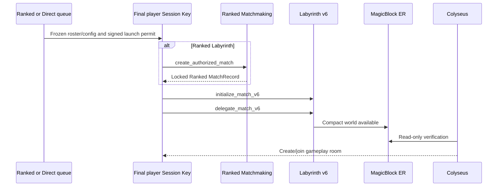

# Compact v6 player-paid ER flow

`labyrinth_pinocchio` v6 is the deployed player-paid Labyrinth path. It uses
the canonical Ranked Matchmaking match ID for Ranked Labyrinth and a canonical
Direct match ID for Labyrinth Direct. It does not own Ranked stake, custody,
payout, withdrawals, or leaderboard data.

## Authority

Colyseus is authoritative for movement, combat, portal occupancy, winner
selection, and the terminal result. It signs immutable launch/terminal facts
and independently observes ER state. It does not submit Labyrinth program
transactions and it never pays player account rent.

The selected player's existing Session Key signs and pays v6 Match creation,
delegation, VRF/reveal requests, and post-match commit. The corresponding Main
Wallet may fund that Session Key before setup. Every player action presents a
Merkle membership proof bound to the backend-signed roster root; an outside
wallet cannot substitute itself.

## Why v6 replaces the eight v5 chunks

v5 preallocated one 5,088-byte Match account and eight 2,848-byte EventChunk
accounts. That gave 256 persisted event payload slots, but required ten setup
transactions and roughly 0.23 SOL of setup rent/metadata/fee budget.

v6 deliberately does not use EventChunks. It uses one 512-byte compact Match
account (current base rent constant: 0.0044544 SOL) with:

- the canonical match ID, origin, Ranked MatchRecord reference, and validator;
- a Merkle root for the Main-Wallet/Session-Key roster;
- deterministic initial spawns and up to 20 room summaries;
- portal, kill, death, respawn, winner, and terminal state;
- an append-only rolling event hash and terminal result hash.

This is the tradeoff: v6 makes bootstrap practical for a player payer and
removes the eight-chunk up-front cost. It retains canonical current state and
an auditable rolling history commitment, but it does not preserve v5's full
on-chain event-payload archive. Colyseus still keeps its gameplay/event log;
the terminal hash anchors the meaningful result on the compact ER account.

## Bootstrap



The game page does not initialize or delegate. It receives the URL Match ID,
subscribes to the ready ER account, requests canonical Match VRF, and starts
terrain generation only after the world is verified.

## Gameplay and room state

Match VRF establishes the canonical terrain seed and deterministic spawn map.
Room summaries are written only once, remain stable for every participant, and
are represented in the compact account. The rolling event hash changes for
meaningful world events; continuous movement, rotation, projectiles, hits, and
HP ticks remain in Colyseus and never create on-chain writes.

## Terminal commit and undelegation

After Colyseus records a terminal result and the compact Match state marks an
extracting player as a winner, that player's Session Key may submit:

```text
commit_match
```

or:

```text
commit_and_undelegate_match
```

The program checks the SessionAuthority PDA, Merkle roster proof, compact Match
PDA, terminal phase, and winner bit before invoking MagicBlock. The player is
therefore the transaction executor; Colyseus remains the gameplay/result
authority and never becomes the payer.

## Compatibility

Existing v4 and v5 Match accounts remain readable by the legacy runtime paths.
New v6 worlds are limited to 20 rooms and 12 players, use compact roster proofs,
and use the v6 permit domain. A v5 account is not silently interpreted as v6.

## Deployment

Configured program: [FbJpQqmiwrf9ZctR4sBQhKqgrUFqD8wfeD2VpZQukACH](https://explorer.solana.com/address/FbJpQqmiwrf9ZctR4sBQhKqgrUFqD8wfeD2VpZQukACH?cluster=devnet).

The deployed v6 ELF is byte-for-byte equal to the local artifact SHA-256:
`e707e80fc16e1883954d472849fd043b4ed7ee6de199ba319b719a2107d0c8aa`.
