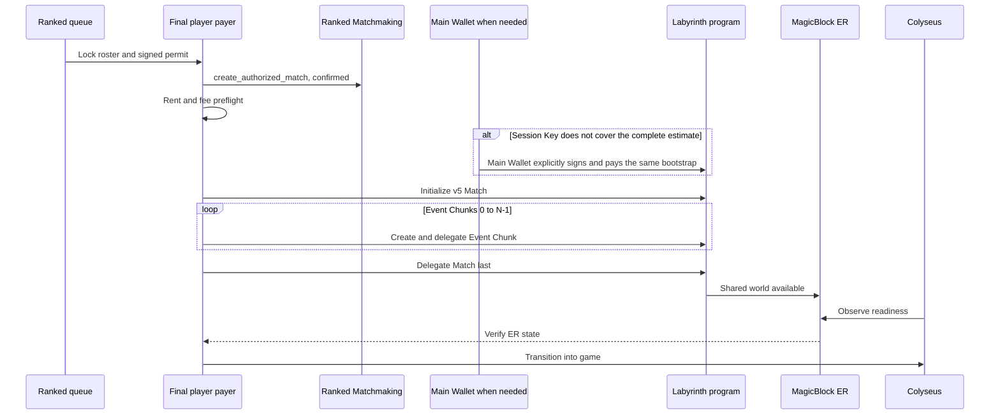
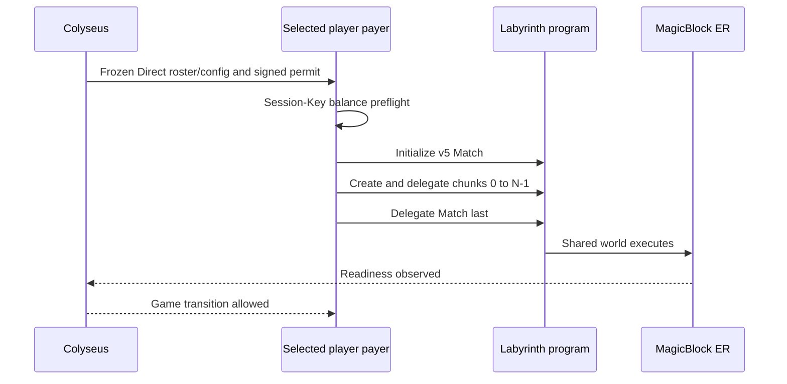
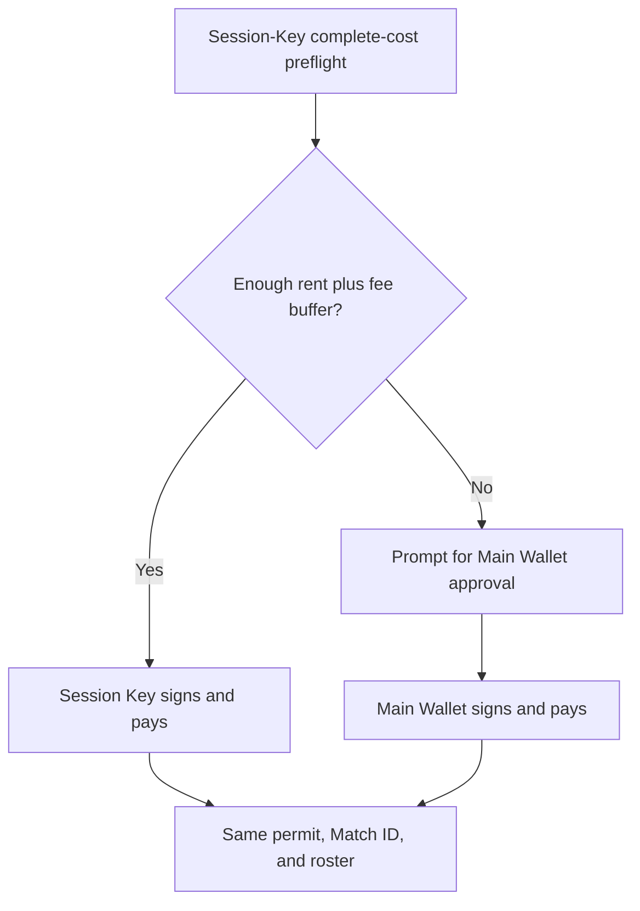
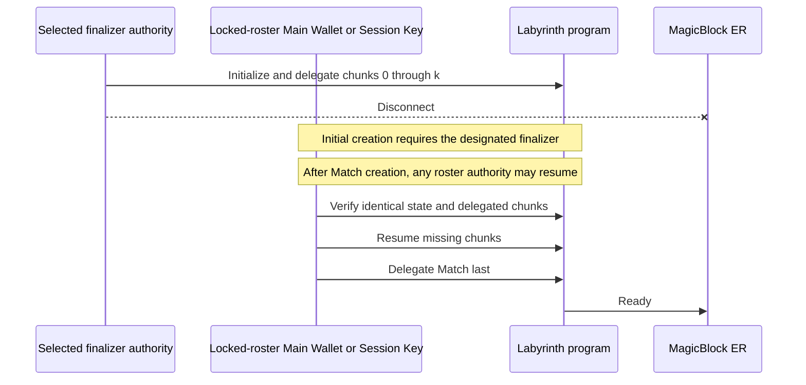

# Player-paid Ephemeral Rollup bootstrap

## Authority and permit

Labyrinth v5 is a player-paid bootstrap protocol. The canonical Ranked
Matchmaking match ID is also the Labyrinth match ID. The configured program is
[FbJpQqmiwrf9ZctR4sBQhKqgrUFqD8wfeD2VpZQukACH](https://explorer.solana.com/address/FbJpQqmiwrf9ZctR4sBQhKqgrUFqD8wfeD2VpZQukACH?cluster=devnet).

The selected finalizer's existing **Session Key** normally signs and pays
Match-account rent, Event Chunk rent, and delegation fees. If it does not
cover the complete preflight, the corresponding **Main Wallet** can be
explicitly selected as payer and signer for the same bootstrap. Both paths are
limited to the designated initializer during creation; neither gives Labyrinth
authority over Ranked stake or payout. MagicBlock ER executes delegated state;
it is not a separate player wallet.

Colyseus freezes roster/configuration, signs an immutable launch permit, and
observes the ER world. It remains authoritative for movement, combat, portal
occupancy, and winner selection. It never submits or pays
`initialize_match`/delegation transactions.

The preceding Ed25519 permit binds program ID, canonical match ID, Ranked
MatchRecord (or zero for Direct), locked roster/Session Authorities, immutable
configuration and rules hashes, ER validator, finalizer index, Main-or-Session
payer policy, permit revision, and Unix expiry time. Altering a signed input
invalidates the permit.

## Ranked: two confirmed stages

“Two stages” does not mean exactly two physical transactions. The Labyrinth
stage may create/delegate the Match and each Event Chunk independently so it
can resume safely.

Ranked Matchmaking and Ranked Leaderboard remain untouched: Ranked handles
money, while Labyrinth owns verifiable world state.

## Direct: immediate player-paid stage

Direct skips Ranked creation and immediately completes the same player-paid
bootstrap after finalizer selection.

## Payer selection

## Recovery and delegation order

Event Chunks are delegated **first**, in index order. The Match is delegated
only when its persistent chunk-delegation mask proves every configured chunk
is ready. Repeated calls verify an existing correct account/delegation instead
of charging rent twice.

Takeover cannot change roster, configuration, validator, or canonical match
ID. Before Match creation the server issues a new permit revision to the next
finalizer. After creation, any locked-roster Main Wallet or Session Key may
finish only the missing chunk/Match delegation operations.

## Rent estimate

The current default has one 5,088-byte Match account and **8** preallocated
2,848-byte Event Chunk accounts. A chunk contains up to **32** compact,
append-only events, so the default preserves **256** important events.

These are not VRF batches and they do not store movement, HP ticks, bullets,
or frame-level gameplay. They preserve room resolutions, kills, respawns,
portal transitions, extraction, and final state so clients/indexers can replay
verifiable match history after ER commits to base Solana.

The chunks are preallocated because the current program validates a fixed,
bounded chunk-account set for event writes. That gives deterministic account
metas during gameplay and lets the delegated-chunk mask prove that the world
is complete before Match delegation. Eight is the default capacity, not an
inherent MagicBlock requirement: a shorter configured match may use fewer
chunks, while the v5 mask supports up to 16. Reducing the count lowers upfront
rent but also lowers the maximum durable event history.

For eight chunks, Match + chunks base rent is approximately **0.20200704 SOL**.
Delegation records/metadata and transaction fees bring the current preflight
estimate to approximately **0.230153280 SOL** before the 0.001 SOL safety
reserve. This is configuration-dependent, not a fixed ER fee.

## Explorer links

- Labyrinth: [Devnet Explorer](https://explorer.solana.com/address/FbJpQqmiwrf9ZctR4sBQhKqgrUFqD8wfeD2VpZQukACH?cluster=devnet)
- MagicBlock VRF: [`Vrf1RNUjXmQGjmQrQLvJHs9SNkvDJEsRVFPkfSQUwGz`](https://explorer.solana.com/address/Vrf1RNUjXmQGjmQrQLvJHs9SNkvDJEsRVFPkfSQUwGz?cluster=devnet)
- MagicBlock Delegation: [`DELeGGvXpWV2fqJUhqcF5ZSYMS4JTLjteaAMARRSaeSh`](https://explorer.solana.com/address/DELeGGvXpWV2fqJUhqcF5ZSYMS4JTLjteaAMARRSaeSh?cluster=devnet)

## Historical v4 server-payer bootstrap

The prior v4 integration used the backend signer as payer and transaction
submitter. This historical flow is preserved for comparison and is not deleted
or rewritten here. It is superseded for new launches because the server should
not pay player world-account rent or submit bootstrap transactions.

The v5 binary was deployed to Devnet in slot `482420384`. The Direct and
Ranked player-paid smoke tests both succeeded before this document was updated.
