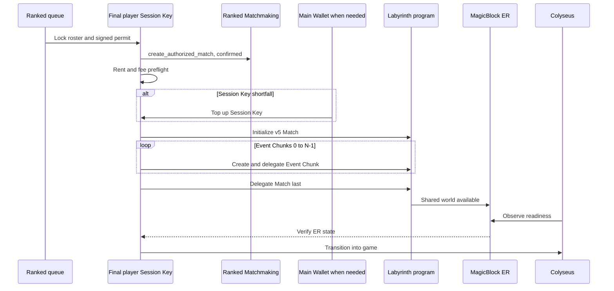
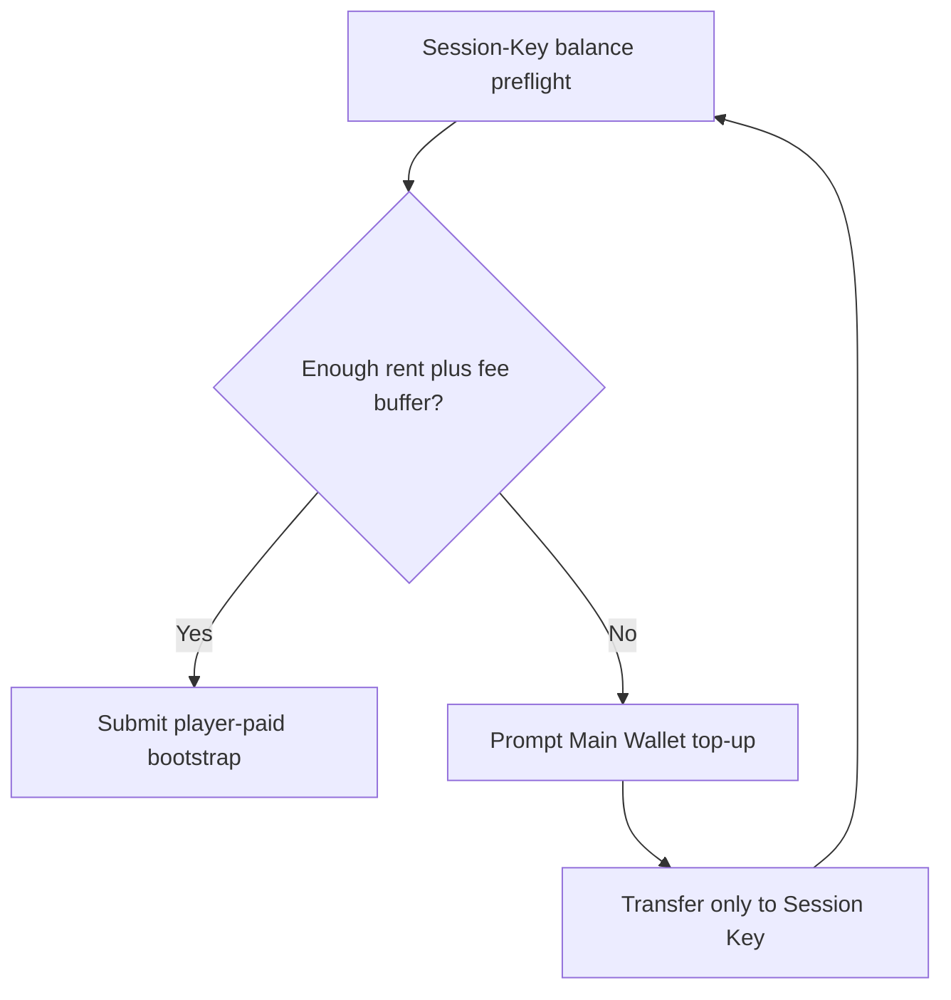
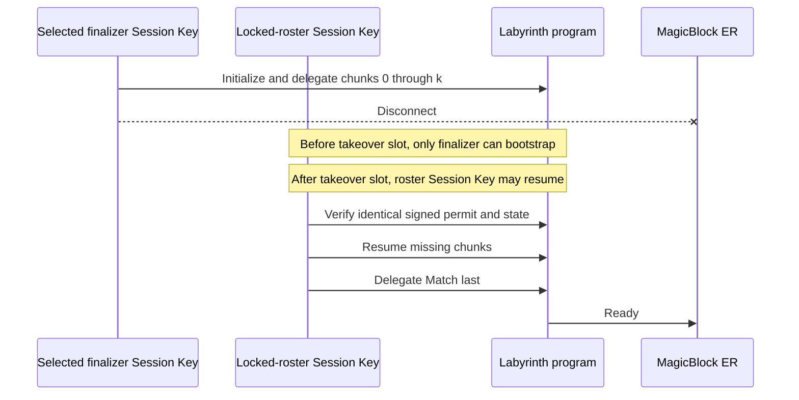

# Player-paid Ephemeral Rollup bootstrap

## Authority and permit

Labyrinth v5 is a player-paid bootstrap protocol. The canonical Ranked
Matchmaking match ID is also the Labyrinth match ID. The configured program is
[FbJpQqmiwrf9ZctR4sBQhKqgrUFqD8wfeD2VpZQukACH](https://explorer.solana.com/address/FbJpQqmiwrf9ZctR4sBQhKqgrUFqD8wfeD2VpZQukACH?cluster=devnet).

The selected finalizer's existing **Session Key** signs and pays Match-account
rent, Event Chunk rent, and delegation fees. The Main Wallet can fund a
Session-Key shortfall beforehand, but it never signs as a Labyrinth payer or
authority. MagicBlock ER executes delegated state; it is not a separate player
wallet.

Colyseus freezes roster/configuration, signs an immutable launch permit, and
observes the ER world. It remains authoritative for movement, combat, portal
occupancy, and winner selection. It never submits or pays
`initialize_match`/delegation transactions.

The preceding Ed25519 permit binds program ID, canonical match ID, Ranked
MatchRecord (or zero for Direct), locked roster/Session Authorities, immutable
configuration and rules hashes, ER validator, finalizer index, Session-Key
payer policy, takeover slot, and expiry slot. Altering a signed input
invalidates the permit.

## Ranked: two confirmed stages

“Two stages” does not mean exactly two physical transactions. The Labyrinth
stage may create/delegate the Match and each Event Chunk independently so it
can resume safely.

Ranked Matchmaking and Ranked Leaderboard remain untouched: Ranked handles
money, while Labyrinth owns verifiable world state.

## Direct: immediate player-paid stage

Direct skips Ranked creation and immediately completes the same player-paid
bootstrap after finalizer selection.

## Main-Wallet shortfall

## Recovery and delegation order

Event Chunks are delegated **first**, in index order. The Match is delegated
only when its persistent chunk-delegation mask proves every configured chunk
is ready. Repeated calls verify an existing correct account/delegation instead
of charging rent twice.

Takeover cannot change roster, configuration, validator, or canonical match
ID. It only allows another locked-roster Session Key to finish the same work.

## Rent estimate

The current configuration has one 5,088-byte Match account and **8**
preallocated 2,848-byte Event Chunk accounts. Base-account rent is
approximately **0.20200704 SOL**, plus a transaction/delegation buffer. This
is configuration-dependent, not a fixed ER fee. The Session Key pays it after
client preflight; a lazy-chunk future design could change the estimate.

## Explorer links

- Labyrinth: [Devnet Explorer](https://explorer.solana.com/address/FbJpQqmiwrf9ZctR4sBQhKqgrUFqD8wfeD2VpZQukACH?cluster=devnet)
- MagicBlock VRF: [`Vrf1RNUjXmQGjmQrQLvJHs9SNkvDJEsRVFPkfSQUwGz`](https://explorer.solana.com/address/Vrf1RNUjXmQGjmQrQLvJHs9SNkvDJEsRVFPkfSQUwGz?cluster=devnet)
- MagicBlock Delegation: [`DELeGGvXpWV2fqJUhqcF5ZSYMS4JTLjteaAMARRSaeSh`](https://explorer.solana.com/address/DELeGGvXpWV2fqJUhqcF5ZSYMS4JTLjteaAMARRSaeSh?cluster=devnet)

## Historical v4 server-payer bootstrap

The prior v4 integration used the backend signer as payer and transaction
submitter. This historical flow is preserved for comparison and is not deleted
or rewritten here. It is superseded for new launches because the server should
not pay player world-account rent or submit bootstrap transactions.

No deployment is claimed by this document. Deploy only after program tests,
artifact verification, and a separate Devnet player-paid smoke test succeed.
